<p align="center">
  
</p>
<div align="center">
  
  ## About Me
  
</div>

```bash
$ whoami
> An7ejl — Full-stack developer

$ cat /etc/status.conf
> [ACTIVE]    Building "TOS" — closed custom operating system
> [LEARNING]  Full-stack architecture · Testing · DevOps
> [MISSION]   Learn more technologies, never stop creating
> [COLLAB]    OPEN — hit me up on Twitter
```

<div align="center">
  
  ## Contacts
  
  [](https://twitter.com/an7ejl)
  [](mailto:your-email@example.com)
  [](https://discord.com/)

</div>

<div align="center">
  
  ## Languages and activity

</div>

<p align="center">
  <a href="https://raw.githubusercontent.com/AN7EJL/AN7EJL/main/.github/workflows/assets/radar.svg">
    
  </a>
</p>
---

<h3 align="center">⟨ <code>TOP.CONTRIBUTED.REPO</code> ⟩</h3>

<div align="center">

<a href="https://github.com/AN7EJL/TOS">
  
</a>

</div>

---
<h3 align="center">⟨ <code>SKILLS</code> ⟩</h3>

<table align="center" style="border-collapse: collapse; background-color: #030305; border-radius: 10px; padding: 20px; border: 1px solid #1a1a2e; box-shadow: 0 0 15px rgba(0, 245, 196, 0.1);">
  <tr>
    <td align="center" valign="top" style="padding: 10px 15px;">
      <b style="color: #00f5c4; font-size: 14px; font-family: monospace; letter-spacing: 1px;">>_ PROGRAMMING</b><br><br>
      <br><br>
      <br><br>
      <br><br>
      <br><br>
      <br><br>
      
    </td>
    <td align="center" valign="top" style="padding: 10px 15px;">
      <b style="color: #00f5c4; font-size: 14px; font-family: monospace; letter-spacing: 1px;">>_ FRONTEND</b><br><br>
      <br><br>
      <br><br>
      <br><br>
      <br><br>
      <br><br>
      
    </td>
    <td align="center" valign="top" style="padding: 10px 15px;">
      <b style="color: #00f5c4; font-size: 14px; font-family: monospace; letter-spacing: 1px;">>_ BACKEND & DEVOPS</b><br><br>
      <br><br>
      <br><br>
      <br><br>
      <br><br>
      <br><br>
      
    </td>
  </tr>
  <tr>
    <td align="center" valign="top" style="padding: 10px 15px;">
      <b style="color: #00f5c4; font-size: 14px; font-family: monospace; letter-spacing: 1px;">>_ DATA & TESTING</b><br><br>
      <br><br>
      <br><br>
      <br><br>
      <br><br>
      
    </td>
    <td align="center" valign="top" style="padding: 10px 15px;">
      <b style="color: #00f5c4; font-size: 14px; font-family: monospace; letter-spacing: 1px;">>_ SOFTWARE</b><br><br>
      <br><br>
      <br><br>
      <br><br>
      
    </td>
    <td align="center" valign="top" style="padding: 10px 15px;">
      <b style="color: #00f5c4; font-size: 14px; font-family: monospace; letter-spacing: 1px;">>_ OTHER</b><br><br>
      <br><br>
      <br><br>
      <br><br>
      <br><br>
      
    </td>
  </tr>
</table>
---

<h3 align="center">⟨ <code>NEURAL.ACTIVITY</code> ⟩</h3>

<div align="center">

<picture>
  <source media="(prefers-color-scheme: dark)" srcset="https://raw.githubusercontent.com/an7ejl/an7ejl/output/github-contribution-grid-snake-dark.svg">
  <source media="(prefers-color-scheme: light)" srcset="https://raw.githubusercontent.com/an7ejl/an7ejl/output/github-contribution-grid-snake.svg">
  
</picture>

</div>

<p align="center">
  
</p>
```
